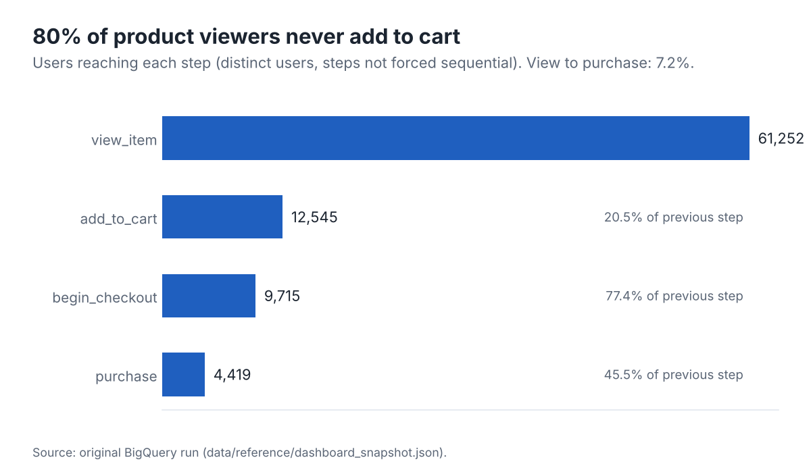
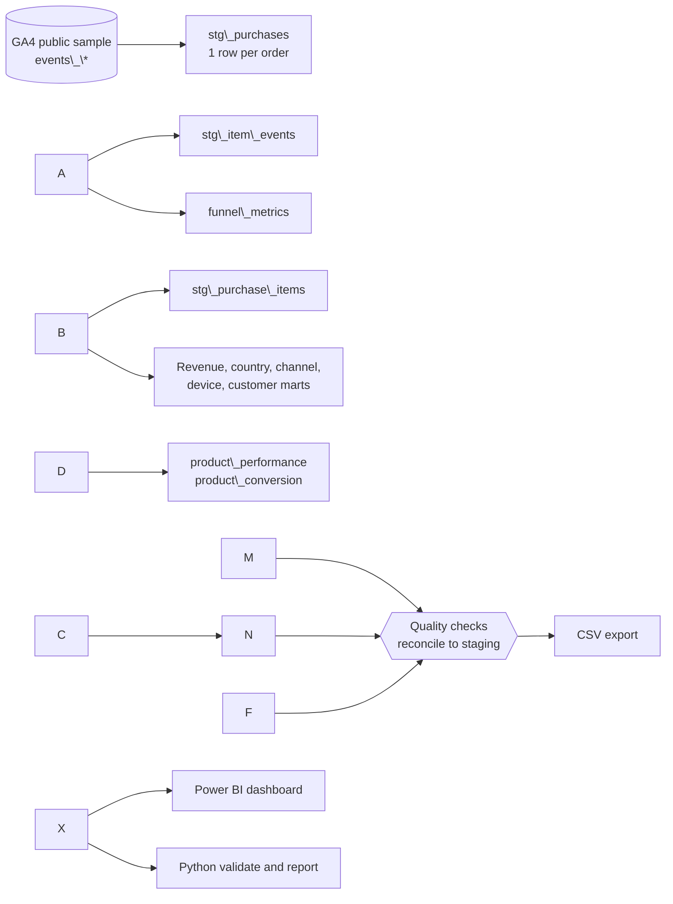

# GA4 Ecommerce Analytics

**Where does an online store lose revenue, and who generates it?** An end-to-end analysis of Google's public GA4 ecommerce sample using BigQuery SQL, a tested Python toolkit and a Power BI dashboard.

!\[Executive overview dashboard](assets/dashboard/overview.png)

|||
|-|-|
|**Data**|\~4.3M GA4 events, 270,154 users, Google Merchandise Store, 1 Nov 2020 to 31 Jan 2021|
|**Headline**|$360.8K revenue from 4,452 orders (AOV $81.05); 7.2% of product viewers purchase|
|**Stack**|BigQuery SQL, Python (pandas, matplotlib), Power BI|
|**Status**|SQL and Python reviewed and unit-tested; **SQL not re-executed in this edition** (see [Verification status](#verification-status))|

## Business problem

A store has traffic, a funnel and a customer base, but the raw GA4 export is nested event data that cannot answer business questions directly. This project turns it into reconciled tables and answers:

1. Where do users drop out of the buying funnel?
2. Do returning customers justify retention work?
3. Which countries and acquisition channels carry revenue?
4. Which products sell, and which attract views but not purchases?
5. How does revenue move over the period?

## Key findings

All figures come from the original BigQuery runs and have not been recomputed here ([provenance and caveats](docs/findings.md)).

|#|Finding|
|-|-|
|1|**20.5%** of product viewers add to cart; **45.5%** of users who start checkout then purchase. The biggest absolute loss is before the cart; the highest-intent loss is at checkout.|
|2|Returning customers are **11.5%** of buyers and **24.5%** of revenue: **$189 vs $76** revenue per customer (2.5x).|
|3|The US is **\~44%** of revenue; US, India and Canada together **\~63%**.|
|4|Revenue fell **\~65%** from December to January (single holiday season, so trend and seasonality cannot be separated).|
|5|Paid search is **\~2.5%** of first-touch revenue, and about **a quarter sits in an ambiguous "Other" bucket** that mixes obfuscated and unclassified sources. No cost data, so no ROI claim.|
|6|Four popular products have 7,600 to 9,600 viewers each and **zero purchases**, which points to an availability or tracking issue worth checking before any marketing change.|

<p>
  
  
</p>
<p>
  
</p>

Recommendations with the evidence for each, framed as hypotheses to test, are in [docs/findings.md](docs/findings.md).

## Architecture



Design choices:

* **One deduplicated staging table** holds the hard logic (one row per `transaction\_id`, channel mapping) so every mart agrees with every other.
* **Marts are small and reconciled**, so the BI layer does no heavy logic.
* **Date-bounded scans** (`\_TABLE\_SUFFIX`) keep BigQuery cost predictable.

## Repository layout

```
.
├── README.md
├── LICENSE
├── pyproject.toml
├── requirements.txt
├── requirements-dev.txt
├── .env.example
├── assets/
│   ├── dashboard/        Power BI screenshots (original outputs)
│   └── figures/          Charts generated by `ga4-analytics report`
├── dashboards/powerbi/   GA4\_Ecommerce\_Dashboard.pbix
├── data/reference/       dashboard\_snapshot.json (numbers transcribed from original runs)
├── docs/                 findings, KPI definitions, data quality, dictionary, interview prep, audit log
├── sql/
│   ├── exploration/      01 discovery, 02 quality (run as is in the console)
│   ├── pipeline/         10 to 12 staging, 20 to 27 marts
│   ├── quality/          90 pipeline checks
│   └── analysis/         30 to 32 analytical queries over the marts
├── src/ga4\_analytics/    config, sql\_runner, metrics, quality, report, cli
└── tests/                unit tests (no cloud access needed)
```

## Data

* Source: `bigquery-public-data.ga4\_obfuscated\_sample\_ecommerce.events\_\*` (details and limitations: [docs/data\_source.md](docs/data_source.md)).
* Limitations that matter: `traffic\_source` is first-touch, there is no `user\_id` (customers are cookie-level `user\_pseudo\_id`), obfuscated values appear as `<Other>` / `(data deleted)`, and three months cannot show long-term retention.
* Schema and table definitions: [docs/data\_dictionary.md](docs/data_dictionary.md).

## KPIs

Revenue, orders, AOV, revenue per customer, funnel step conversion, product conversion and revenue share are defined, with interpretation and limitations, in [docs/kpi\_definitions.md](docs/kpi_definitions.md). One example of why definitions matter: the original README reported "AOV" of $76 and $189 for customer types, but those are revenue per customer.

## The pipeline, step by step

|Step|Files|What it does|
|-|-|-|
|1. Explore|`sql/exploration/`|Event types, users, date range, completeness of purchase and item fields|
|2. Stage|`sql/pipeline/10` to `12`|Keep the first event per `transaction\_id`, drop placeholder IDs, map channels, flatten items|
|3. Model|`sql/pipeline/20` to `27`|Marts at one clear grain each, with `SAFE\_DIVIDE` and shares|
|4. Check|`sql/quality/90\_pipeline\_checks.sql`|Totals of every mart must equal staging; severity levels error, warn, info|
|5. Analyse|`sql/analysis/`|Overview, funnel and customers, products|
|6. Present|`dashboards/`, `assets/`|Power BI dashboard, README figures|

The most important transformation, deduplicating orders so revenue, orders and AOV agree:

```sql
SELECT ecommerce.transaction\_id, user\_pseudo\_id, ecommerce.purchase\_revenue, ...
FROM `bigquery-public-data.ga4\_obfuscated\_sample\_ecommerce.events\_\*`
WHERE \_TABLE\_SUFFIX BETWEEN '20201101' AND '20210131'
    AND event\_name = 'purchase'
    AND ecommerce.transaction\_id NOT IN ('', '(not set)')
QUALIFY ROW\_NUMBER() OVER (PARTITION BY ecommerce.transaction\_id ORDER BY event\_timestamp) = 1
```

## Dashboard

Four pages, built in Power BI from the exported marts.

|Executive overview|Customers and funnel|
|-|-|
|!\[Overview](assets/dashboard/overview.png)|!\[Customers and funnel](assets/dashboard/customer\_and\_funnel\_analysis.png)|
|**Product performance**|**Acquisition and audience**|
|!\[Products](assets/dashboard/product\_performance.png)|!\[Acquisition](assets/dashboard/acquisition\_and\_audience.png)|

Known dashboard issues (recorded, not yet fixed in the `.pbix`): the monthly line is sorted by revenue instead of month, and the product conversion ranking has no minimum-traffic filter. See [docs/data\_quality.md](docs/data_quality.md).

## Reproduce it

**Prerequisites:** Python 3.10+, a Google Cloud project with BigQuery enabled, and the [gcloud CLI](https://cloud.google.com/sdk/docs/install). No paid resources are needed for the tests or the offline report; use `--dry-run` to see how many bytes the pipeline will scan before running it.

```bash
# 1. Install
python -m venv .venv \&\& source .venv/bin/activate      # Windows: .venv\\Scripts\\activate
pip install -r requirements-dev.txt \&\& pip install -e .

# 2. Offline checks, no cloud access needed
pytest                              # or: python -m unittest discover -s tests -t .
ruff check .
ga4-analytics report                # rebuilds assets/figures from the reference snapshot

# 3. Configure BigQuery (no secrets are stored in the repo)
gcloud auth application-default login
cp .env.example .env                # edit GA4\_GCP\_PROJECT\_ID, then:
export $(grep -v '^#' .env | xargs)

# 4. Run against BigQuery
ga4-analytics run --dry-run         # estimate bytes scanned
ga4-analytics run                   # builds staging and marts in your dataset
ga4-analytics check                 # exits 1 if any error-severity check fails
ga4-analytics export                # writes data/processed/\*.csv
ga4-analytics validate              # offline reconciliation of the exports
ga4-analytics report --source exports
```

SQL execution order is the filename order in `sql/pipeline/`, then `sql/quality/`. The `sql/exploration/` files run directly in the console.

### Troubleshooting

|Symptom|Fix|
|-|-|
|`GA4\_GCP\_PROJECT\_ID is not set`|Copy `.env.example` to `.env`, edit, and `export` it|
|`Access Denied` / `bigquery.jobs.create`|Your account needs the BigQuery Job User role on your project|
|`Not found: Dataset ... was not found in location`|Set `GA4\_BQ\_LOCATION=US`; the public sample is in the US multi-region|
|`ModuleNotFoundError: ga4\_analytics`|Run `pip install -e .` from the repo root|
|Dry run says "skipped" for some files|Expected: later steps read tables that do not exist until the first real run|

## Verification status

Honest account of what was and was not checked when this edition was prepared.

|Check|Result|
|-|-|
|Python unit tests (`unittest`, 52 tests)|51 passed, 1 skipped (BigQuery-dialect SQL parse needs `sqlglot`; runs in CI)|
|`ruff` lint|Passed|
|SQL structure tests (brackets, placeholders, date bounds, no hardcoded project, no `SELECT \*`)|Passed|
|SQL executed on BigQuery|**Not run** (no network access to BigQuery from the build environment)|
|BigQuery-dialect SQL parse|**Not run locally**|
|Power BI file opened|**No** (inspected as an archive only)|
|CI workflow|Written, not yet run on GitHub|

Run `ga4-analytics run \&\& ga4-analytics check` first; the checks are designed to confirm or refute the open reconciliation items in [docs/data\_quality.md](docs/data_quality.md).

## Limitations and next steps

* Findings are descriptive, not causal, and rest on one holiday season.
* Customer identity is cookie-level; first-touch attribution cannot support last-click ROI.
* Next: session-level attribution; a sequenced (cohort) funnel; incremental loads into partitioned tables; statistical testing for the recommendations; fix the two dashboard issues above.

## Skills demonstrated

SQL (CTEs, window functions, `UNNEST`, `QUALIFY`, deduplication), BigQuery cost control, analytics engineering (staging and marts, reconciliation checks), Python packaging and testing, KPI design and documentation, BI dashboarding, data storytelling with explicit caveats.

## Further reading

[Findings and recommendations](docs/findings.md) · [KPI definitions](docs/kpi_definitions.md) · [Data quality](docs/data_quality.md) · [Data dictionary](docs/data_dictionary.md) · [Interview preparation](docs/interview_prep.md) · [Audit log](docs/audit_log.md)

## Credits

Original SQL analysis and Power BI dashboard: Swarnim Deshpande. This edition adds the deduplicated pipeline, quality checks, Python toolkit, tests, corrected documentation and repository structure.


